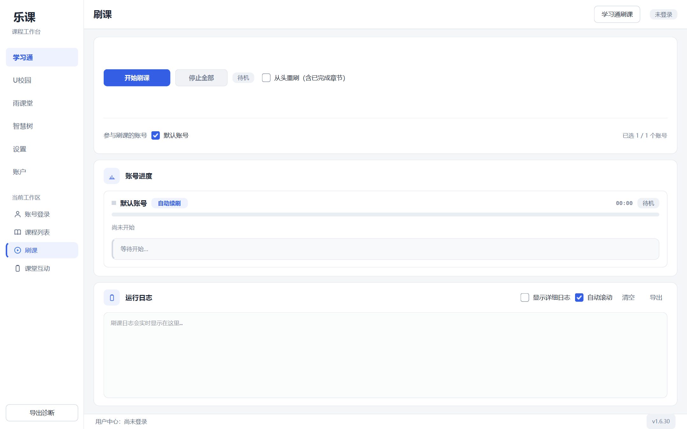
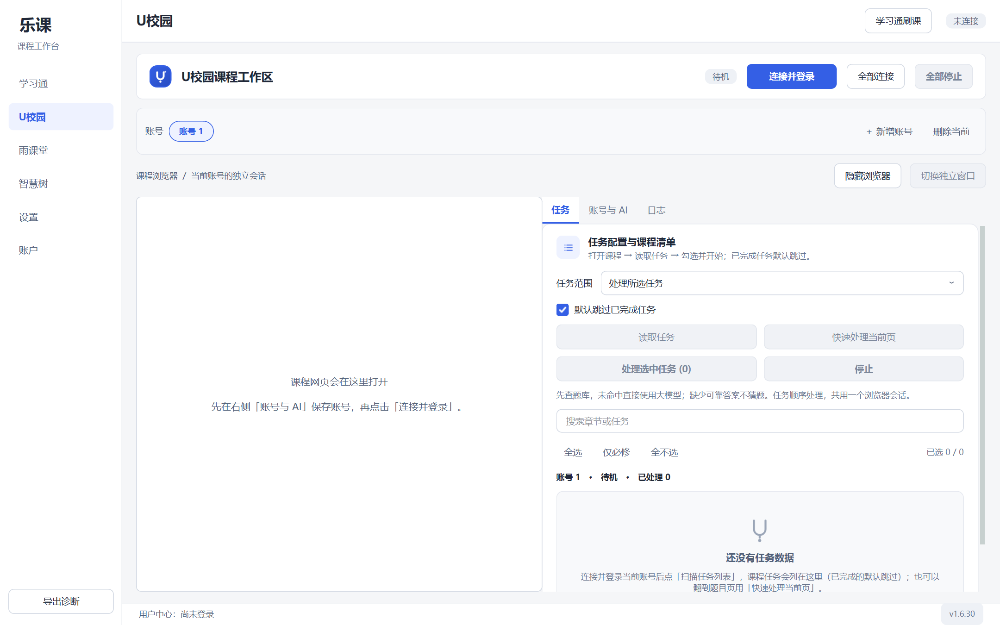
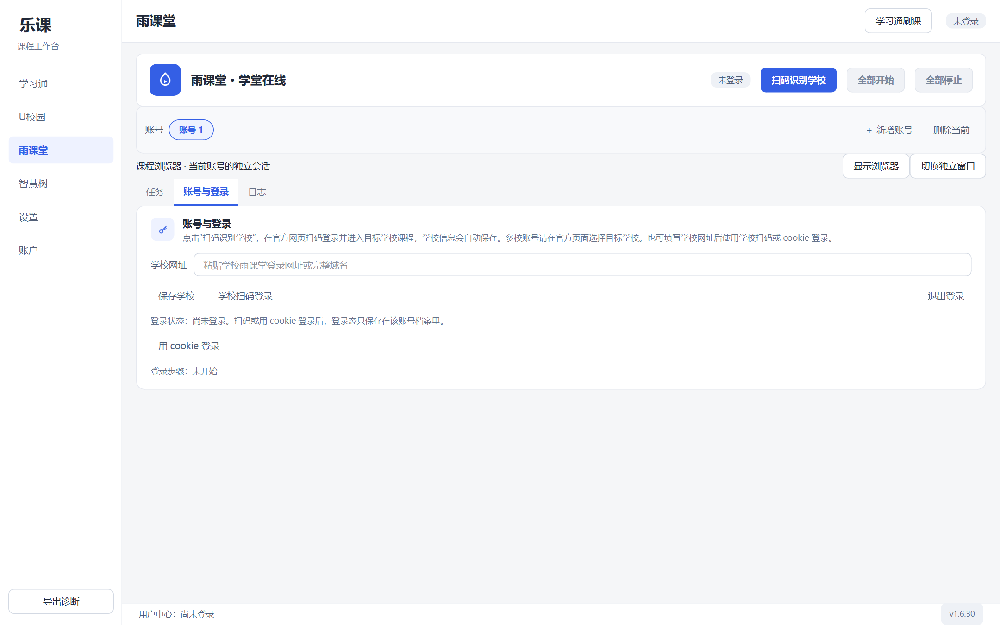
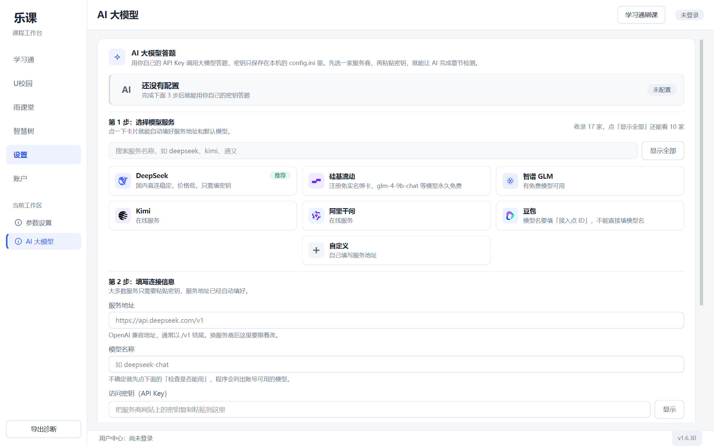
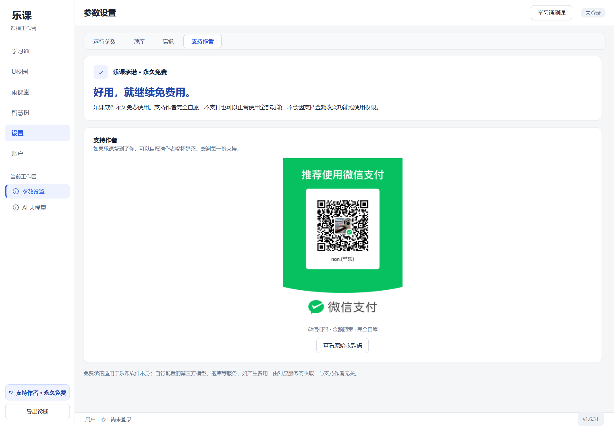

# 乐课

Windows 桌面多平台刷课助手，搭配ai大模型，集中管理学习通、雨课堂、智慧树与 U校园账号和课程任务。

[下载最新版](https://github.com/niuniu513-ask/leke/releases/latest) · [用户中心](https://kc-api.lifedays.site/) · [反馈问题](https://github.com/niuniu513-ask/leke/issues) · [安全说明](SECURITY.md)

> **完全免费。** 本仓库提供客户端源码、版本下载与问题反馈。注册登录用于乐课账号、设备管理与云端题库访问。源码与第三方许可说明见下文。

## 真实界面截图

以下为客户端实际运行界面（工作区为 1.6.30，支持作者页为 1.6.31），使用隔离的空白账号环境；未展示真实课程、个人账号或完成记录。

### 学习通任务工作台



### U校园工作区



### 雨课堂工作区



### AI 与答题设置



### 支持作者 · 永久免费

设置页或侧栏底部可打开支持作者页面。微信扫码完全自愿，不支持也可正常使用全部功能。软件本身永久免费，自行配置的第三方服务费用以服务商为准。



## 下载与使用

1. 从 [Releases](https://github.com/niuniu513-ask/leke/releases/latest) 下载 `leke-版本号-win-x64.exe`，适用于 Windows x64。
2. 将程序放入自己有写入权限的独立文件夹，双击运行。单文件版本首次启动需要解包，请耐心等待。
3. 注册或登录乐课账号，添加课程平台账号并读取课程，再选择任务。部分平台需要先完成扫码、验证码或学校统一认证。
4. 任务结束后重新读取进度，并到课程平台核对。缺答案、题型未支持、批改未完成或网络异常时，任务可能保持未完成。

更换版本前，请退出旧程序并备份同目录的配置、账号档案和浏览器档案。不要同时运行多个版本操作同一份数据，也不要把 Cookie、账号文件和配置上传到公开仓库。

1.6.30 起随正式发布提供 `SHA256SUMS.txt`；旧版本如未附校验文件，可参考 GitHub Release 附件的摘要。校验示例：

```powershell
Get-FileHash .\leke-1.6.31-win-x64.exe -Algorithm SHA256
```

对照当前 Release 的校验值；校验值用于确认下载文件一致，不能替代发布者数字签名。不要使用第三方重新打包或所谓破解版。

## 支持范围

| 平台或模块 | 当前能力 | 使用边界 |
| --- | --- | --- |
| 学习通 | 多账号、课程与章节读取、视频与文档任务、章节测验、任务进度核对 | 题型、权限及服务器返回影响实际结果；填写答案、保存草稿、提交和通过是不同状态 |
| 雨课堂 | 独立浏览器会话、登录与课程读取；对适配课程提供视频和练习处理 | 不同学校及课程版本存在差异，部分内容需在浏览器中手动完成 |
| U校园 | 内置浏览器工作区、账号会话隔离、课程任务处理与题库/模型辅助 | 听力、视频及特殊页面依赖可解析内容和已配置的模型能力 |
| 智慧树 | 已适配的视频任务链路 | 不代表已支持全部校区、课程类型和测验 |
| 答题来源 | 云端共享题库、其他已配置题库（可以自由配置）与大模型回退 | 没有有效答案时不猜题；模型可能答错；未配置或不可用时不会凭空生成答案 |
| 课堂互动 | 对已适配的活动提供读取与操作入口 | 动态二维码等需按提示使用官方客户端；所有操作须本人确认具备权限 |

**不承诺每所学校、每门课程或每种题型都可自动完成，也不保证成绩。** 平台显示的最终提交、批改及进度记录才是核对依据。

## 隐私与数据

- 课程平台账号、密码、Cookie 及浏览器会话档案保存在本机，并用于登录相应平台。**这些文件不应作为问题附件公开。** DPAPI 加固仅覆盖乐课登录令牌，不代表所有平台凭据都已加密。
- 乐课账号认证、设备信息、使用事件与用量统计会发送到乐课服务端。
- 云端题库功能会向乐课服务端发送题目及答案，供共享查询和答案沉淀；请勿上传无权共享的资料。
- 启用外部题库或大模型时，相关题目及必要上下文会发送给所选服务商。模型服务可能单独计费，以服务商规则为准。

## 问题反馈

请在 [Issues](https://github.com/niuniu513-ask/leke/issues) 中提供：软件版本、Windows 版本、平台及故障步骤、预期结果与实际表现。可附经过脱敏的日志片段和截图。

请删除密码、Cookie、Bearer Token、验证码、学生姓名、学号和带认证参数的链接。安全漏洞请按 [SECURITY.md](SECURITY.md) 私下反馈，不要在公开 Issue 中张贴可利用细节或真实凭据。

## 源码、第三方与使用约定

客户端的第三方声明载明：学习通核心基于 GPL-3.0 项目，U校园引擎基于 AGPL-3.0 项目。因此原 README 对整个客户端作“闭源、保留所有权利”的表述不准确，对应源码分发需遵守实际适用的上游许可。

客户端源码见 [client/](client/)，运行和构建步骤见 [SOURCE_BUILD.md](SOURCE_BUILD.md)。[1.6.31 Release](https://github.com/niuniu513-ask/leke/releases/tag/v1.6.31) 同时提供 EXE、完整对应源码包及 SHA-256 校验文件。Git 目录省略超过 100 MB 的语音模型文件，完整源码包保留该文件。服务端源码、账号、Cookie、私有密钥及运行数据不在公开交付范围内。

软件还使用 PySide6、浏览器自动化、语音处理及其他第三方组件。许可证与声明随新安装包附带；第三方组件按各自许可证使用。

请遵守学校、课程平台和模型服务商的规定，仅操作本人或已获明确授权的账号，不得冒用他人身份或绕过平台验证。软件免费，自愿支持作者不影响功能使用。

© 2026 niuniu513-ask 及各上游贡献者。具体文件权利与使用条件以适用许可证和第三方声明为准。
